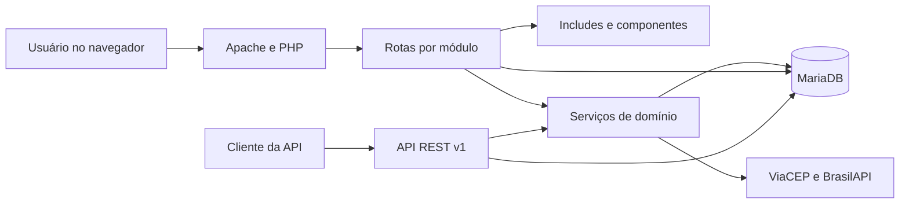
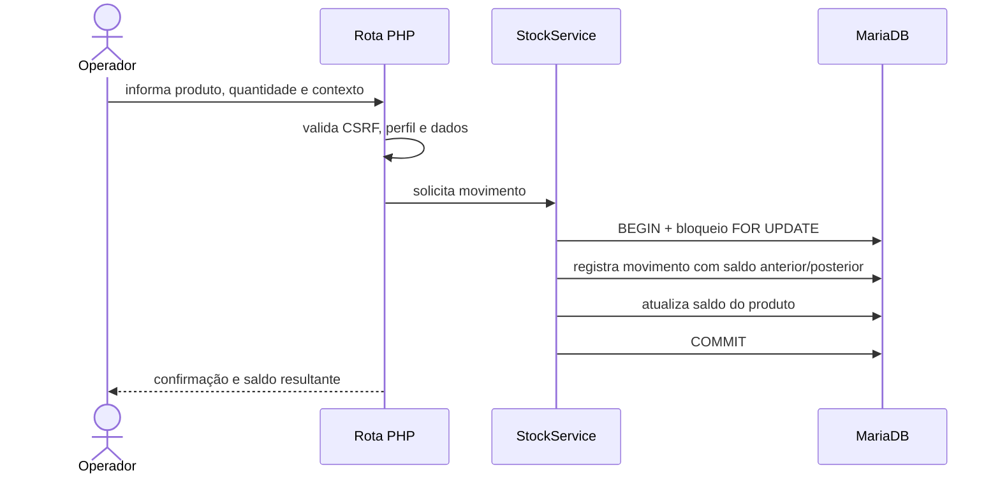
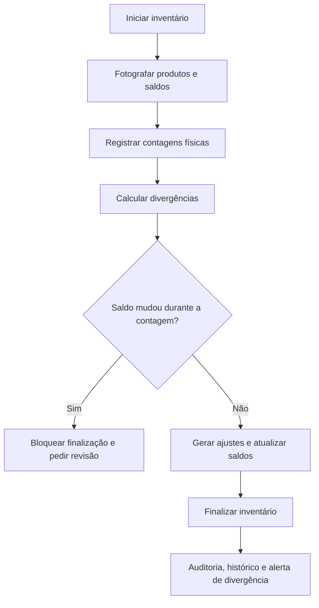

# Arquitetura do SmartControl

## Visão geral

O SmartControl utiliza uma arquitetura web server-side modular, compatível com Apache, PHP 8.2 e MariaDB. As rotas PHP existentes foram preservadas para evitar regressões, enquanto regras críticas foram extraídas para serviços com autoload PSR-4.

## Camadas e responsabilidades

| Camada | Local | Responsabilidade |
|---|---|---|
| Bootstrap | `config/` | ambiente, sessão, erros, conexão PDO e configuração de e-mail |
| Rotas web | pastas de negócio | receber HTTP, validar entrada, autorizar e montar a resposta HTML |
| Serviços | `src/Services/` | estoque transacional, autenticação da API, verificação de e-mail e consultas externas |
| Infraestrutura HTTP | `src/Http/` | respostas JSON padronizadas |
| Componentes | `includes/` | layout, navegação, helpers, CSRF, auditoria e notificações |
| Persistência | MariaDB + `database/` | dados relacionais, constraints, índices e migrations |
| Interface | `assets/` | identidade visual, responsividade, acessibilidade e melhorias com JavaScript |
| Operação | `storage/` | uploads não executáveis e logs fora das rotas públicas permitidas |

## Módulos

- `auth/` e `account/`: login, logout POST, verificação, recuperação e conta.
- `products/`, `categories/`, `suppliers/`: cadastros e pesquisa.
- `stock/`: entrada, saída, ajuste administrativo e histórico.
- `inventory/`: abertura, contagem, revisão, finalização e cancelamento.
- `dashboard/` e `reports/`: indicadores, filtros, impressão e CSV.
- `notifications/` e `audit/`: alertas operacionais e trilha administrativa.
- `users/` e `settings/`: administração, configurações e tokens da API.
- `api/v1/`: API REST interna somente leitura.
- `integrations/`: gateway autenticado para consultas de CEP e CNPJ.

## Decisões arquiteturais

1. PHP server-side permanece como base; não há SPA ou framework pesado.
2. `StockService` é o único caminho novo para entradas, saídas e ajustes manuais. Ele usa transação e `SELECT ... FOR UPDATE`.
3. O saldo atual fica em `produtos` para leitura rápida, mas cada alteração gera uma linha rastreável em `movimentacoes`.
4. A API usa tokens aleatórios armazenados apenas como SHA-256, expiração, revogação e limite de requisições.
5. Integrações externas têm timeout, TLS validado, fallback e nunca impedem o preenchimento manual.
6. Credenciais e parâmetros locais ficam no `.env`, que não é versionável.

## Fluxo de estoque

## Fluxo de inventário

## Limites intencionais

- O projeto não implementa multiempresa nem depósitos múltiplos.
- A API v1 é somente leitura.
- O envio SMTP é opcional; alertas internos continuam disponíveis sem e-mail.
- QR Code foi mantido como trabalho futuro: SKU e código de barras já cobrem identificação e leitores USB sem acrescentar dependência apenas decorativa.

## Incrementos desta revisão

`UserService` centraliza alterações administrativas com proteção do último administrador. As rotas de estoque envolvem `StockService` e auditoria na mesma transação. `inventory/review.php` implementa revisão explícita das fotografias para nova contagem física; versão da contagem e ID da última movimentação detectam concorrência. A listagem de itens é paginada sem apagar outras páginas ao salvar.

A arquitetura continua incremental: páginas antigas ainda contêm consultas SQL e HTML. Não foi realizada migração total para MVC nem removidas funcionalidades por preferência de organização.
