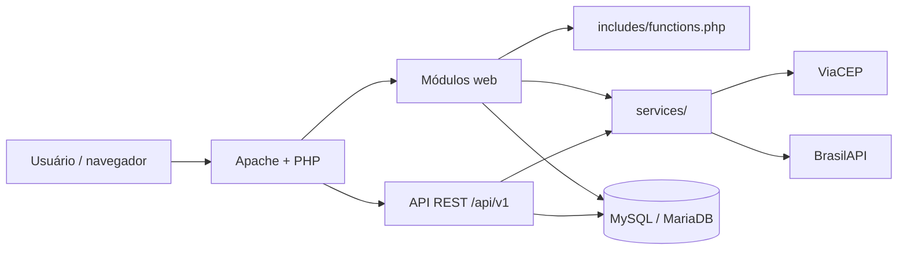
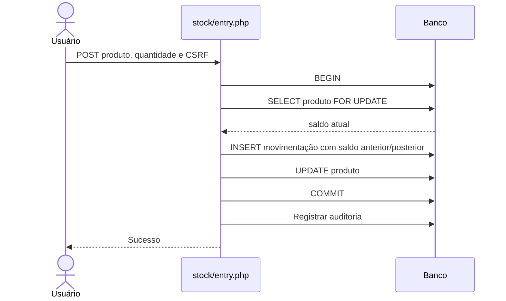

# Arquitetura do SmartControl

## Visão geral

O SmartControl mantém uma arquitetura PHP server-side simples. As pastas de domínio funcionam como controladores/rotas e renderizam suas próprias views, enquanto recursos comuns ficam em `config/`, `includes/` e `services/`.

A opção foi evoluir a base existente sem introduzir um framework apenas para aumentar a complexidade do TCC.

## Camadas práticas

### Configuração

- `config/environment.php`: carrega variáveis do `.env` e do ambiente do servidor.
- `config/config.php`: sessão, timezone, headers, tratamento global de exceções e bootstrap.
- `config/database.php`: conexão PDO.
- `config/email.php`: configuração SMTP.

### Regras compartilhadas

`includes/functions.php` concentra autenticação, autorização, CSRF, mensagens, formatação, auditoria e notificações.

### Domínios

- produtos: `products/`;
- categorias: `categories/`;
- fornecedores: `suppliers/`;
- estoque: `stock/`;
- inventário: `inventory/`;
- relatórios: `reports/`;
- usuários: `users/`;
- auditoria: `audit/`;
- notificações: `notifications/`.

### Serviços externos

`services/ExternalApiService.php` encapsula consultas externas. A regra é que uma falha externa nunca impeça o preenchimento manual nem o funcionamento do controle de estoque.

### API

`api/v1/` oferece uma interface JSON versionada. A autenticação pode usar sessão ou Bearer token, cujo valor bruto é exibido somente no momento da criação e cujo hash SHA-256 é persistido.

## Fluxo de uma entrada de estoque

## Fluxo de inventário

1. Um inventário aberto é criado com uma fotografia dos produtos e do saldo registrado.
2. As quantidades físicas são preenchidas em `inventario_itens`.
3. O sistema calcula `diferenca = quantidade_contada - estoque_sistema`.
4. Na finalização, o inventário e os produtos envolvidos são bloqueados na transação.
5. Para cada divergência é criada uma movimentação com origem `inventario`.
6. O estoque do produto é atualizado para a quantidade contada.
7. O inventário passa a `finalizado`, preservando os dados históricos.

## Decisões de projeto

- PHP server-side continua sendo a base; JavaScript melhora interação, mas não transforma o sistema em SPA.
- Movimentações de estoque são imutáveis pela interface: correções acontecem por nova movimentação/ajuste, mantendo rastreabilidade.
- APIs externas são auxiliares, não dependências de negócio.
- O sistema usa soft status (`ativo`) em cadastros em vez de apagar registros vinculados.
- A API de negócio é somente leitura nesta versão para evitar uma segunda implementação das regras críticas de estoque.
