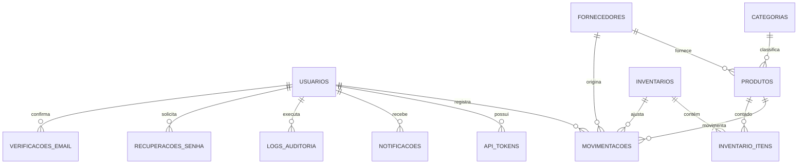

# Banco de dados

## Plataforma e instalação

O esquema usa InnoDB, `utf8mb4` e chaves estrangeiras. É compatível com MariaDB 10.4+ e com os recursos de MySQL equivalentes. Para instalação limpa, importe `database/smartcontrol.sql`. Para a base da versão enviada em 24/09, faça backup e aplique uma única vez apenas `2026_09_24_conclusao.sql`. Instalações novas não devem executar as migrations após o SQL completo.

## Modelo lógico



## Tabelas

| Tabela | Finalidade |
|---|---|
| `usuarios` | identidade, hash de senha, perfil, situação e verificação |
| `categorias` | classificação de produtos |
| `fornecedores` | dados comerciais, documento e endereço estruturado |
| `produtos` | cadastro, SKU, código de barras, preços e saldo atual |
| `movimentacoes` | trilha imutável de entradas, saídas e ajustes |
| `inventarios` | cabeçalho e ciclo de vida da contagem física |
| `inventario_itens` | fotografia inicial, contagem, diferença e ajuste |
| `logs_auditoria` | eventos administrativos e dados antes/depois |
| `notificacoes` | alertas internos por usuário |
| `anexos` | metadados dos arquivos relacionados a produtos |
| `configuracoes` | parâmetros funcionais não secretos |
| `tentativas_login` | bloqueio temporal de autenticação |
| `limites_requisicao` | rate limiting com identificador em hash |
| `recuperacoes_senha` | tokens de redefinição em hash e com validade |
| `verificacoes_email` | tokens de confirmação em hash e com validade |
| `api_tokens` | credenciais da API em hash, validade e revogação |

## Integridade e índices

- FKs usam `RESTRICT`, `SET NULL` ou `CASCADE` conforme o ciclo de vida do dado.
- SKU, código de barras, e-mail e documento de fornecedor possuem unicidade.
- Um índice único sobre coluna gerada garante no máximo um inventário aberto.
- Movimentações guardam quantidade, saldo anterior, saldo posterior, origem, responsável e vínculos opcionais.
- Índices cobrem datas, situação, nomes, FKs, filtros de relatório e autenticação.
- A aplicação não permite saldo negativo e os testes conferem continuidade do histórico.

## Regras transacionais

Entradas, saídas e ajustes executam na mesma transação:

1. bloqueio do produto com `FOR UPDATE`;
2. validação do saldo e do contexto;
3. inserção da movimentação;
4. atualização de `produtos.quantidade_estoque`;
5. auditoria administrativa (nas rotas web);
6. commit ou rollback integral.

Na finalização do inventário, produtos e inventário são bloqueados. Se algum saldo ou ID de última movimentação mudou desde a fotografia, a operação é recusada para evitar sobrescrever uma movimentação concorrente.

## Migrations disponíveis

- `2026_09_08_atualizar_schema.sql`: base da evolução anterior.
- `2026_09_21_limites_requisicao.sql`: rate limiting.
- `2026_09_21_rastreabilidade_estoque.sql`: saldos, origem e vínculos de movimento.
- `2026_09_21_api_tokens.sql`: tokens da API.
- `2026_09_21_endereco_fornecedores.sql`: endereço estruturado.
- `2026_09_21_documento_fornecedor_unico.sql`: unicidade do documento normalizado.

## Backup e restauração

Exemplo local, ajustando usuário, porta e caminho:

```bash
mysqldump --single-transaction --routines --triggers -u root -p smartcontrol > smartcontrol-backup.sql
mysql -u root -p smartcontrol < smartcontrol-backup.sql
```

Não versione dumps reais: eles podem conter dados pessoais, hashes e informações operacionais.

## Alterações desta entrega

- `usuarios.auth_version`: revoga sessões após alterações administrativas, inclusive bloquear/reativar.
- `inventarios.revisao`: controle otimista de alterações concorrentes na contagem.
- `inventario_itens.ultimo_movimento_id`: ID da última movimentação na fotografia; não é FK, pois -1 indica fotografia legada pendente de revisão.
- Migração `2026_09_24_conclusao.sql`: somente aditiva, uma execução; preserva dados existentes.
- Conexões PDO utilizam o fuso -03:00, consistente com os horários da aplicação.
- Nenhum dump de dados reais acompanha a entrega. O SQL de instalação cria uma base de demonstração e não usa DROP.
