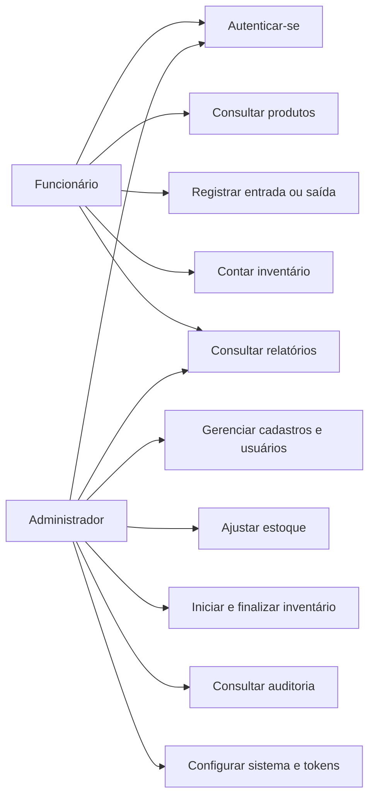

# Material acadêmico do SmartControl

## Tema e problema

Pequenas e médias empresas frequentemente controlam estoque com planilhas isoladas, registros manuais ou sistemas que não preservam a origem das alterações. Isso favorece divergências, estoque negativo, compras atrasadas e dificuldade para identificar quem realizou determinada operação.

O problema de pesquisa é: **como um sistema web de baixo custo pode tornar o controle de estoque mais íntegro, rastreável e útil para a tomada de decisão sem impor uma infraestrutura complexa?**

## Solução proposta

O SmartControl é uma aplicação web responsiva para cadastros, entradas, saídas, ajustes, inventário físico, relatórios, alertas e auditoria. A solução mantém PHP e MariaDB como tecnologias acessíveis, mas aplica separação de responsabilidades, transações, segurança em camadas, API REST e testes de integridade.

## Objetivo geral

Desenvolver e validar uma plataforma web segura e rastreável para apoiar o gerenciamento de estoque de pequenas e médias empresas.

## Objetivos específicos

1. Centralizar produtos, categorias, fornecedores e usuários.
2. Impedir saídas superiores ao saldo disponível.
3. Registrar toda mudança de estoque com saldo anterior e posterior.
4. Apoiar inventário físico e correção auditável de divergências.
5. Disponibilizar indicadores, filtros e relatórios exportáveis.
6. Aplicar autenticação, autorização, CSRF, validação e tratamento seguro de erros.
7. Demonstrar integração por API REST, consulta de CEP/CNPJ e código de barras.
8. Oferecer interface responsiva e recursos razoáveis de acessibilidade.
9. Verificar as regras críticas com testes automatizados e checklist manual.

## Atores e casos de uso

## Requisitos funcionais

| ID | Requisito implementado |
|---|---|
| RF01 | autenticar usuário ativo e controlar sessão |
| RF02 | verificar e-mail e recuperar senha por token temporário |
| RF03 | gerenciar usuários com perfis administrador e funcionário |
| RF04 | gerenciar produtos, categorias e fornecedores |
| RF05 | gerar SKU e armazenar código de barras único |
| RF06 | localizar produto por nome, SKU ou código de barras |
| RF07 | registrar entrada com fornecedor, valor e observação |
| RF08 | registrar saída com motivo e validação do saldo |
| RF09 | realizar ajuste administrativo com justificativa |
| RF10 | consultar histórico com origem, responsável e saldos |
| RF11 | iniciar, contar, revisar, finalizar e cancelar inventário |
| RF12 | gerar movimentos automáticos para divergências do inventário |
| RF13 | exibir dashboard com indicadores e série semanal |
| RF14 | emitir relatórios filtráveis, imprimíveis e exportáveis em CSV |
| RF15 | consultar CEP e CNPJ, mantendo edição manual disponível |
| RF16 | emitir alertas de estoque, divergência, volume incomum e segurança |
| RF17 | registrar eventos administrativos em auditoria |
| RF18 | expor consultas pela API REST v1 autenticada |
| RF19 | anexar documentos ou imagens a produtos com validação |

## Requisitos não funcionais

| ID | Requisito |
|---|---|
| RNF01 | funcionar em PHP 8.2, Apache e MariaDB 10.4+ |
| RNF02 | usar UTF-8, layout responsivo e navegação por teclado |
| RNF03 | proteger operações com autenticação, autorização e CSRF |
| RNF04 | usar prepared statements e escape contextual de saída |
| RNF05 | concluir alterações críticas de estoque atomicamente |
| RNF06 | não expor detalhes técnicos em produção |
| RNF07 | paginar consultas de maior volume e limitar a API |
| RNF08 | não depender de API externa para concluir cadastros |
| RNF09 | manter credenciais fora do código-fonte |
| RNF10 | preservar compatibilidade com leitores USB que simulam teclado |

## Regras de negócio

- RN01: somente usuários ativos e com e-mail verificado entram no sistema.
- RN02: a saída não pode resultar em estoque negativo.
- RN03: ajuste direto de saldo é exclusivo de administrador e exige justificativa.
- RN04: toda alteração de saldo gera movimento com responsável e saldos anterior/posterior.
- RN05: só pode existir um inventário aberto por vez.
- RN06: um inventário só finaliza depois que todos os itens forem contados.
- RN07: se o saldo mudar durante a contagem, a finalização é bloqueada.
- RN08: finalização preserva os itens e gera os movimentos de divergência.
- RN09: SKU, código de barras, e-mail e documento de fornecedor não se repetem.
- RN10: tokens da API aparecem uma vez, podem expirar e podem ser revogados.
- RN11: funcionário não acessa rotas administrativas mesmo por URL direta.
- RN12: falha de ViaCEP/BrasilAPI nunca bloqueia o preenchimento manual.

## Arquitetura e banco

A aplicação usa arquitetura modular server-side. Rotas coordenam requisições, serviços concentram regras críticas, includes fornecem componentes e MariaDB garante relações e índices. Detalhes estão em `docs/ARCHITECTURE.md` e `docs/DATABASE.md`.

O saldo atual é uma projeção de leitura rápida em `produtos`. A tabela `movimentacoes` guarda a prova de cada transição. Os testes comparam o saldo atual ao último movimento e verificam a continuidade entre saldos.

## Segurança

A defesa é composta por hash de senha, sessão endurecida, CSRF, bloqueio de login, rate limiting, autorização no backend, PDO nativo, validação server-side, headers HTTP, proteção de arquivos internos, tokens em hash, tratamento global de exceções e logs técnicos. Consulte `docs/SECURITY.md`.

## Integrações e interoperabilidade

- ViaCEP é a primeira fonte de endereço por CEP.
- BrasilAPI é fallback de CEP e fonte de dados de CNPJ.
- A API REST v1 fornece produtos, categorias, fornecedores, inventários, movimentos e indicadores.
- Leitores USB funcionam como teclado: o código digitado seleciona o produto nas telas de movimento e ajuste.

## Estratégia de testes

A suíte automatizada valida ambiente, 16 tabelas, colunas de rastreabilidade, constraint de inventário, ausência de saldo negativo, continuidade histórica, CSRF, XSS, transações de estoque e autenticação da API. Modos opcionais testam integração externa real e HTTP sobre Apache. O checklist manual cobre fluxos de interface, perfis, inventário, relatórios, uploads, responsividade e acessibilidade.

## Resultados técnicos observáveis

- Alterações de estoque atômicas e rastreáveis.
- API autenticada e versionada.
- Banco com constraints e migrations preservando dados.
- Alertas internos e auditoria administrativa.
- Interface adaptável e navegação consistente.
- Relatórios gerenciais com filtros e exportação.
- Documentação reproduzível de instalação e teste.

## Limitações

- Um único estoque lógico; não há múltiplos depósitos.
- Dois perfis fixos, sem matriz granular de permissões.
- API v1 somente leitura.
- Sem operação offline ou aplicativo móvel neste repositório.
- Integrações de CNPJ dependem da disponibilidade pública do provedor, embora o cadastro manual continue funcional.
- Não há geração de QR Code nesta versão; SKU e código de barras atendem o fluxo atual.

## Trabalhos futuros

- depósitos, lotes, validade e inventário por localização;
- pedidos de compra e sugestão de reposição;
- permissões granulares e autenticação multifator;
- testes end-to-end com navegador em pipeline CI;
- observabilidade centralizada e métricas;
- API de escrita com escopos específicos;
- etiquetas com QR Code quando existir um fluxo que justifique o recurso;
- aplicativo móvel sincronizado com a API.

## Sugestão de demonstração para a banca

1. Mostrar dashboard e um produto com saldo baixo.
2. Ler o SKU/código no campo de entrada e registrar uma entrada.
3. Tentar uma saída maior que o saldo e demonstrar o bloqueio.
4. Fazer um ajuste como administrador e abrir o histórico.
5. Criar um inventário, contar um item divergente e finalizar.
6. Exibir relatório de divergências e CSV.
7. Consultar CEP/CNPJ de fornecedor e explicar o fallback manual.
8. Gerar um token, consultar a API e revogá-lo.
9. Mostrar auditoria, alertas e os resultados dos testes efetivamente executados (consulte FINAL_AUDIT.md).

## Incrementos para demonstrar na banca

1. Bloquear um funcionário que está conectado em outro navegador e comprovar a interrupção do acesso.
2. Fazer entrada e saída de mesma quantidade durante um inventário e demonstrar que a finalização exige revisão e recontagem.
3. Abrir o inventário em duas sessões: salvar em uma e demonstrar que a outra não sobrescreve silenciosamente a contagem.
4. Consultar a API com paginação e mostrar que ela recusa token revogado.
5. Distinguir análise sintática, teste isolado JavaScript, integração com banco e validação manual. Não apresentar testes não executados como aprovados.
